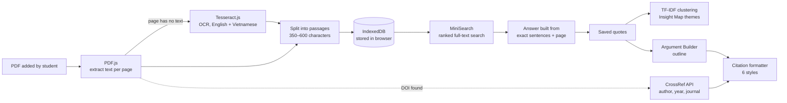
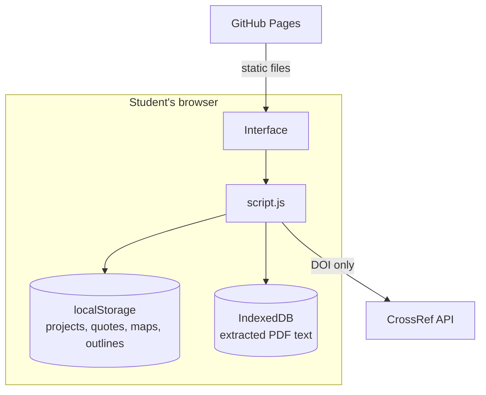

# Trace & Think

**Research with clarity. Think with evidence.**

Trace & Think is a research workspace for university students. You add the PDFs for an assignment, ask them questions, keep the quotes you need and turn them into an outline. Every quote stays linked to its file and page, and citations are formatted in the reference style you choose.

🔗 **Live site:** https://ngoctieu0207.github.io/trace-and-think/

> To try it, open the live site, create a project and add any academic PDF (text-based or scanned). Everything runs in your browser.

---

## Contents

1. [What is worth solving](#1-what-is-worth-solving)
2. [Tool chain](#2-tool-chain)
3. [Economics](#3-economics)
4. [Prototype](#4-prototype)
5. [Back end analysis](#5-back-end-analysis)
6. [Iteration](#6-iteration)
7. [Reflection](#7-reflection)
8. [Polish](#8-polish)
9. [Theory applied](#9-theory-applied)
10. [Limitations and future work](#10-limitations-and-future-work)
11. [Credits, licences and AI use](#11-credits-licences-and-ai-use)

---

## 1. What is worth solving

Every semester brings research and far too much to read. Finding sources, reading, remembering and turning notes into an argument are all hard. From my own experience as a student, three problems keep coming back:

| Problem | What happens |
|---|---|
| **100 tabs, nowhere to take notes** | PDFs are open everywhere, with no single place to keep the parts that matter. |
| **“Which file was that quote in?”** | It is hard to remember which file and page a quote came from, and finding it again takes ages. |
| **AI summaries make things up** | Tools like ChatGPT often get sources wrong and even invent references that do not exist. |

The third problem is the most serious, because a fabricated reference can cost marks and raises academic integrity issues. This shaped the main design decision of the project: **the app never writes its own answers. It only shows exact sentences from the student’s own files, with the page number.**

**Who it is for:** university students working on essays, literature reviews and capstone projects, especially RMIT students (English and Vietnamese interface, Easy Cite reference styles).

---

## 2. Tool chain



| Layer | Tool | Why it was chosen |
|---|---|---|
| Interface | HTML, CSS, vanilla JavaScript | No framework needed; small, fast, easy to host as a static site |
| Icons and fonts | Lucide, Inter, Source Serif 4 | Clean academic look; serif type marks original quotes |
| Reading PDFs | **PDF.js** (Mozilla) | Reads the text layer of a PDF inside the browser |
| Scanned pages | **Tesseract.js** | OCR for pages that are only images; loaded only when needed |
| Search | **MiniSearch** | Ranked full-text search with prefix and fuzzy matching |
| Storage | **IndexedDB** + localStorage | Extracted text is too large for localStorage; projects, quotes and outlines persist between visits |
| Reference data | **CrossRef REST API** | Free, no key; returns metadata for a DOI |
| Translation (optional) | Chrome built-in **Translator API** | On-device translation of Vietnamese questions; used only when available |
| Hosting | GitHub + **GitHub Pages** | Free static hosting with version history |

### What I explored and the problems I hit

| Exploration | Challenge | How it was solved |
|---|---|---|
| Reading PDFs in the browser | The first version only stored file names, so questions about my own files could not be answered | Switched to PDF.js and split each page into searchable passages |
| OCR for scanned pages | OCR is slow and the library is large | Tesseract is loaded only when a page has no text; capped at the first 40 scanned pages |
| Answers without inventing anything | Generative AI needs a paid API key, which cannot be hidden on a public static site, and it can invent content | Extractive answers: rank passages with MiniSearch, then pick the sentences that share the most terms with the question |
| Vietnamese questions on English readings | Chrome’s Translator API hung without responding in testing | Added time limits (2.5 s) and a fallback to keyword search, plus a tip suggesting English keywords |
| Losing text after a reload | Extracted text did not fit in localStorage | Moved passages to IndexedDB |
| Wrong citations for uploaded files | Uploaded PDFs had no author or year, so citations used the file name | Detect a DOI in the first pages and fetch details from CrossRef; added a form to enter details by hand |
| Grouping quotes into themes without AI | No semantic model available offline | TF-IDF vectors and average-link clustering, with themes the student can rename and edit |

---

## 3. Economics

| Item | Cost |
|---|---|
| Hosting (GitHub Pages) | Free |
| Server or database | None needed |
| AI API calls | None (answers are extractive) |
| CrossRef API | Free, no key |
| Libraries | Free and open source |
| **Running cost per user** | **About $0** |

**Trade-off:** because the processing happens on the student’s own computer, there is no server bill, but slower laptops take longer to OCR scanned PDFs. A version with accounts, cloud sync or generative AI would need a paid backend (for example hosting, a database and per-request AI fees), which would also raise privacy questions about uploading students’ files.

---

## 4. Prototype

A working web app with five areas:

- **Dashboard:** projects, progress through the four steps, recent activity.
- **Evidence Library:** add PDFs, ask questions, search, save quotes with file, page and in-text citation; edit reference details or look up a DOI.
- **Insight Map:** saved quotes grouped into themes; suggested similarity links; links marked as Similar, Different or Opposing with a note; drag and drop.
- **Argument Builder:** main argument, supporting points, counterargument and response; drag quotes onto sections; copy the outline with a reference list.
- **Settings:** language (English or Vietnamese) and reference style (RMIT Harvard, APA 7th, IEEE, Chicago B, Vancouver, AGLC4).

The app also has a landing page, a short onboarding tour and a picture-based guide at the top of each page.

---

## 5. Back end analysis

Trace & Think deliberately has **no server of its own**. All processing happens in the browser.



**Why no backend**

- **Privacy:** students’ PDFs never leave their computer. Only a DOI is sent to CrossRef.
- **Trust:** no generative AI model means no invented sentences or references.
- **Security:** no API keys to hide on a public site.
- **Cost and simplicity:** free hosting, nothing to maintain, fits a self-contained HTML submission.

**What this costs**

- Data lives in one browser only; it is not synced across devices and is lost if browser data is cleared.
- Search matches words, not meaning, so a question phrased very differently from the source may find less.
- Large scanned PDFs are slow on low-end devices.

**What a backend would add, if the project continued**

| Need | Possible backend piece |
|---|---|
| Use the same projects on laptop and phone | Accounts and a database (for example Supabase or Firebase) |
| Search by meaning, across languages | An embedding model, either in the browser or on a server |
| Group work | Shared projects with permissions |
| Better reference detection without a DOI | A metadata service or a model that reads the title page |

---

## 6. Iteration

Each version came from testing the previous one and finding what did not work. The commit history in this repository shows the steps.

| Version | What changed | Why |
|---|---|---|
| 1. First prototype | Dashboard, Evidence Library, Insight Map and Argument Builder with sample data and simulated answers | To test the overall workflow and layout |
| 2. Language, referencing and onboarding | English and Vietnamese, RMIT Easy Cite styles, a landing page and a skippable tour | A first-time visitor did not know what the site was for or where to start |
| 3. Real documents | PDF.js, OCR, search and extractive answers; sample data removed | A question about my own uploaded PDF could not be answered |
| 4. Correct citations | DOI detection with CrossRef, a form for source details, italic titles when there is no author | Citations for uploaded files used the file name and were wrong |
| 5. Real map and outline | Themes from TF-IDF clustering, user-made links, drag and drop; outline uses real quotes | The map and outline only worked with the sample project |
| 6. Simpler guidance and copy | Text guides replaced with picture tiles; all text rewritten in a plainer tone; notification bell and other unused parts removed | Long instructions were not being read, and some text sounded unnatural |

---

## 7. Reflection

> ✍️ *To be written by the author.* Suggested questions:
> - What did I learn about building something that works with real documents rather than sample data?
> - Which technical choice am I most happy with, and which would I change?
> - What surprised me during testing?
> - What insight did this give me about AI tools in academic work?

---

## 8. Polish

- English and Vietnamese interface; quotes always stay in the original language.
- Picture-based guide on every page, which can be hidden and reopened.
- Live reading progress for each file, clear empty states and error messages.
- Layout adapts to desktop and tablet.
- Keyboard support (Enter, Escape, arrow keys in the tour), visible focus outlines, labelled buttons, and up/down buttons as an alternative to drag and drop.
- The guide animations stop when the system asks for reduced motion.

---

## 9. Theory applied

| Theory | Where it shows up in Trace & Think |
|---|---|
| **Nielsen’s usability heuristics** (Nielsen 1994) | *Visibility of system status:* reading progress (“Reading… 40%”). *Recognition rather than recall:* every quote shows its file and page. *Error prevention:* confirmation before deleting. *Help and documentation:* a guide on every page. |
| **Progressive disclosure** (Nielsen 2006) | The tour and guides can be skipped or hidden; the source form only shows the fields that fit the source type. |
| **Gestalt principles** (proximity, similarity) | The Insight Map places each theme’s quotes in one column with one colour. |
| **Guidelines for human-AI interaction** (Amershi et al. 2019) | The system makes clear what it did (exact sentences, ranked locally), supports correction (rename themes, keep or dismiss suggested links) and never presents invented content as fact. |
| **Information foraging theory** (Pirolli and Card 1999) | Search highlights matching words and answers jump straight to the passage and page, reducing the cost of finding information. |
| **Cognitive load theory** (Sweller 1988) | One task per page, a fixed four-step flow, and short picture tiles instead of long text. |
| **Privacy by design** (Cavoukian 2009) | Processing stays on the device by default; only a DOI leaves the browser. |

**Insight from applying them:** for academic tools, being able to trace a statement back to its source matters more than a fluent answer. Showing the exact sentence and page gives up some convenience but keeps the student in control of their evidence.

### References

Amershi S, Weld D, Vorvoreanu M, Fourney A, Nushi B, Collisson P, Suh J, Iqbal S, Bennett PN, Inkpen K, Teevan J, Kikin-Gil R and Horvitz E (2019) ‘Guidelines for human-AI interaction’, *Proceedings of the 2019 CHI Conference on Human Factors in Computing Systems*, ACM, New York.

Cavoukian A (2009) *Privacy by design: the 7 foundational principles*, Information and Privacy Commissioner of Ontario, Toronto.

Nielsen J (1994) ‘Enhancing the explanatory power of usability heuristics’, *Proceedings of the SIGCHI Conference on Human Factors in Computing Systems*, ACM, New York.

Nielsen J (2006) *Progressive disclosure*, Nielsen Norman Group website, accessed 5 November 2026. https://www.nngroup.com/articles/progressive-disclosure/

Pirolli P and Card S (1999) ‘Information foraging’, *Psychological Review*, 106(4):643–675.

Sweller J (1988) ‘Cognitive load during problem solving: effects on learning’, *Cognitive Science*, 12(2):257–285.

---

## 10. Limitations and future work

- Themes and similarity are based on shared words, not meaning. Next step: a small embedding model running in the browser.
- Vietnamese questions on English documents rely on keywords or on Chrome’s translator when available.
- Author and year are found automatically only when the PDF contains a DOI.
- Data is stored in one browser; there are no accounts or sync.
- Export to Word and testing with a group of students would be the next improvements.

---

## 11. Credits, licences and AI use

### Libraries and services

| Name | Use | Licence |
|---|---|---|
| [PDF.js](https://mozilla.github.io/pdf.js/) (Mozilla) | Reading PDF text | Apache-2.0 |
| [Tesseract.js](https://tesseract.projectnaptha.com/) | OCR for scanned pages | Apache-2.0 |
| [MiniSearch](https://lucaong.github.io/minisearch/) | Full-text search | MIT |
| [Lucide](https://lucide.dev/) | Icons | ISC |
| [Inter](https://rsms.me/inter/) and [Source Serif 4](https://github.com/adobe-fonts/source-serif) via Google Fonts | Typography | SIL Open Font License |
| [CrossRef REST API](https://www.crossref.org/documentation/retrieve-metadata/rest-api/) | Reference details from a DOI | Public API |

Reference formatting follows the guidance in [RMIT Easy Cite](https://www.lib.rmit.edu.au/easy-cite/). Trace & Think is an independent student project and is not affiliated with RMIT University.

### Use of generative AI

> ✍️ *Please check and adjust this to match how you actually used AI.*
>
> I used Claude (Anthropic) as a coding assistant to help write and debug the HTML, CSS and JavaScript, and to draft parts of this README. The idea, the problem, the target audience and the decisions about features and design were my own, and I tested and reviewed the result.

### Running it locally

The app is three static files (`index.html`, `style.css`, `script.js`). Serve the folder with any static server (opening the file directly may block some browser features), for example:

```bash
npx serve .
```

### Licence

Released under the Apache-2.0 licence. See [LICENSE](LICENSE).
